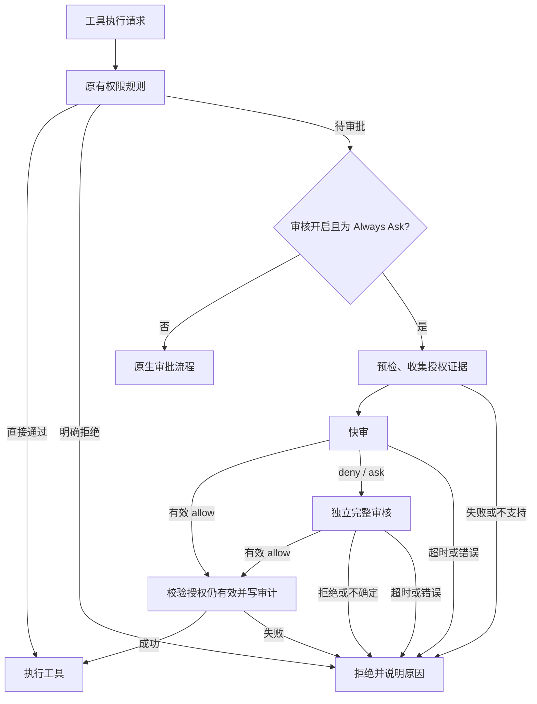

# 原生接入架构

关闭两阶段时，从证据收集直接进入完整审核。任一模型调用均不提供工具，避免审核器执行操作。

## 引擎

`overlay/packages/agent-core-v2/src/agent/approvalReview/` 包含配置、证据构造、JSON 判决校验、模型调用、时限、审计和失败计数。`patches/native-review.patch` 将服务接入 `toolApprovalService`，在实际待审批位置给出通过或拒绝结果。它还修复该基线未载入配置权限规则的问题，以保留显式 allow/deny/ask 的语义。

证据构造通过 `toolCallId` 将历史 `Read` 调用与结果绑定，只选择与待审路径直接相关的文本，或当前包清单明确引用的已读本地脚本。完整性同时依据读取参数和工具状态：分页或截断结果不完整，显式字符上限需要工具确认请求范围完整且已到文件末尾。该内容放在独立的不可信字段中，只用于分析行为，不能建立用户授权；无关工具输出发送前即被排除。

审核系统策略只包含固定规则和可信附加策略。证据正文按稳定字段顺序构造，`pending_action` 位于最后，fast/full 阶段指令追加在证据之后；第二阶段复用相同证据而不读取第一阶段结论。这为跨阶段及相邻动作提供了可复用的缓存前缀，但实际缓存命中取决于 provider 和历史是否变化，不等于持久授权。

原来的业务确认路径保留；一般待审批工具不会打开传统权限弹窗，唯一人工覆盖是精确动作的一次授权。引擎会拒绝缺失、无效和抛异常的审核结果，避免静默继续执行。审核模型层复用上游的可恢复错误分类、每个阶段最多 10 次尝试、指数退避、`Retry-After` 和可取消等待，显示 `Retrying (n/10)`；所有尝试共用该次审核的总超时。每轮同时维护连续安全拒绝和最近 50 个结果的滚动窗口，审计保留全部拒绝用于诊断，停轮只计算安全拒绝。审计故障会拒绝执行，但不会覆盖模型原有的安全结论及停轮计数，内存历史同时保留该安全结论和最终审计故障。基础设施故障单独计数，连续两次后进入 30 秒冷却，之后允许同轮重试，不占用安全停轮预算；证据不足也不触发安全停轮。拒绝提示允许拆分出真正缩小副作用、可独立验证的新步骤，但仍禁止通过其他工具或路径达到同一被拒绝的效果。

### 精确动作的一次授权

引擎只对 main agent 的真实模型非 critical 拒绝登记最多 10 个内存挑战，并通过现有 `ToolUpdate.customData` 发出含工具名和参数的结构化记录。TUI 优先关联已开始的工具调用，缺失时使用挑战中的信息，因此拒绝早于开始或迟于结束事件也能登记并展示 `/auto-review denials`。`/approval`（别名 `/approve`）列出拒绝，Enter 将选中项从 ✗ 变为 ✓ 并通过正常用户输入管线发送一次授权，再按 Enter 或 Esc 关闭；只有发送成功才显示成功。无 ID 的 `/auto-review approve` 共用选择器，显式 ID 和 `denials` 保留为兼容诊断入口。授权前重新核对 session、模式和挑战，不直接执行工具。

下一次审核先验证用户通道、挑战、session/agent、完整 `{tool,args,cwd}` 指纹和 `prefixRevision()`，再在首次模型调用前原子消费。授权只增加 `verified_one_time_user_approval` 证据，仍须正常 fast/full 复审，不能绕过 protected action、显式 ask、critical 或确定性风险约束。审计只记录 `overrideUsed`，不记录挑战值或原始参数。

挑战不持久化，compaction、undo、clear、session reset 和进程重启使其失效。结构化授权文本始终从普通授权请求中过滤，importContext 文本另标为不可信来源，避免历史内容持续或被冒充为当前授权。该机制不生成 allow 规则，不是持久授权台账。

### 真实回答与审批记录

除直接用户提示外，证据收集接受 shell input，但排除 shell output。问题回答与审批决策来自现有 `interactions` facade，而不是工具返回中的自述文本。查询限定当前 session 和 main agent 的已解决记录；即使子代理审核读取根代理上下文，也不能让子代理自己的 interaction 建立根授权。

原生审批上下文向 interaction 补充 `toolInput`、cwd 和 `approvalRule`。审批证据只有在 `resolved + approved`、字段完整且 `{tool,args,cwd}` 指纹完全匹配时才进入 `verified_human_approvals`。一次批准在首次模型审核前加入 agent 内存消费集合；原审批流程接受一次批准时也会消费它，历史中已出现原工具调用的记录同样排除，避免用旧批准重复执行。session 批准不进入一次消费集合，但只有对应 session approval rule 仍存在时才可使用。原始记录及其 `createdAt` 仍参与授权指纹，因此消费本身不会误报撤权，替换同 ID 记录会使决定失效。授权指纹同时覆盖直接请求、一次授权挑战、真实审批和问题回答，审核期间任何新增或变化都会使决定失效。

问题回答以 `human_question_answers` 独立传递，问题文本标为 `questions_untrusted`，回答仅用于理解精确意图；支持问题文本键和无歧义的选项 label 归一化。两类新证据都不绕过正常 fast/full 审核、确定性预检或风险约束。审计仅增加 `humanApprovalUsed` 布尔值，不记录原始参数、回答内容或 interaction ID；模型自由生成的理由不写入审计，固定为查看会话记录的提示，静态预检原因仍保留。facade 的最近已解决记录采用限时、限量的惰性清理，不提供跨重启持久授权。

## SDK 与 TUI

SDK 配置 schema 和 TOML 映射暴露审核设置。TUI 的 `/auto-review` 通过 SDK 读写配置、会话权限和结构化工具进度，底栏显示状态。一次授权复用现有 `customData` 和正常用户输入通道，不新增公共 SDK/klient 契约。TUI 不直接导入引擎服务，审批也不依赖屏幕自动点击。

## 为什么需要独立运行时

在锁定的官方 2.3.0 基线上，普通工具钩子的放行结果仍会继续进入核心审批流程，权限通知钩子也不能直接解决原生待审批请求。因此本项目修改核心审批入口并构建独立 JavaScript 运行时，脚本将 `autokimi` 指向它。

官方 `kimi` 文件不变。使用独立命令隔离版本，但默认共用账号和配置。项目目前没有承诺其他 Kimi 版本兼容，也没有把该能力包装成不改核心的通用插件。

## 源码与运行包

`upstream.lock.json` 固定官方精确提交。准备器只在新临时目录里还原该提交、应用补丁并复制新增文件，成功后才移动至 `.cache/kimi-code`。缓存的输入指纹和源码状态不匹配时会拒绝复用。

构建产物不进 Git。生产打包前重新验证锁定提交、输入指纹和源码状态。打包器复制运行时、SDK 及生产依赖的实际内容，用包内相对链接重建依赖关系；完整文件内容、权限和链接目标共同决定 release。安装时复核整包摘要、验证版本，并在 per-home 锁内更新配置、受管理启动器和回执，失败时回滚。摘要用于发现意外变更，不是签名验证。

## 可选上游跟随

日常构建继续使用根 `upstream.lock.json`。维护者显式跟随另一版本时，候选生成器会生成独立锁，依次验证官方 CDN 版本、Git tag、npm tarball 的 SHA-512、注册表签名和 provenance 中的 commit。任何一项不一致都停止，不进入构建。兼容判断还包括 Node、pnpm 和原生依赖声明，不做“接口看似没变就放行”的默认承诺。

候选在独立 worktree 中应用同一套 overlay/补丁并执行构建、相关回归和安装烟测，最后才生成候选运行包与报告。只有显式 `--install` 或传入候选锁的安装命令才会切换；失败保留当前 launcher、receipt 和 release。

安装包还包含 `build-kit/`，其中保存 overlay、补丁、构建工具、测试和文档，使 `autokimi update` 能在没有开发仓库的情况下执行同一流程。该目录参与整包摘要，更新工作和报告放在 `KIMI_CODE_HOME/autokimi/update-work`，不写回只读 release。启动器只在第一个参数精确为 `update` 时进入跟随命令，其他启动仍直接执行官方 main，没有后台或启动时更新。
