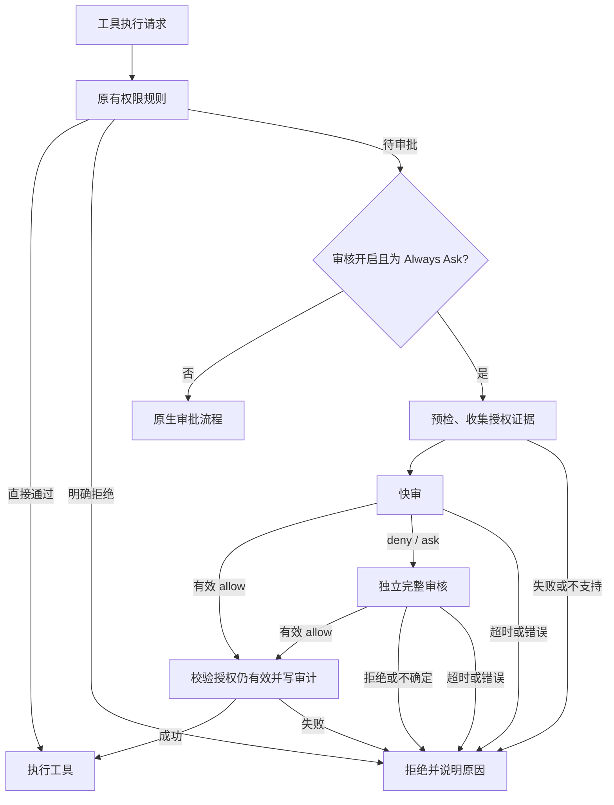

# 原生接入架构

关闭两阶段时，从证据收集直接进入完整审核。任一模型调用均不提供工具，避免审核器执行操作。

## 引擎

`overlay/packages/agent-core-v2/src/agent/approvalReview/` 包含配置、证据构造、JSON 判决校验、模型调用、时限、审计和失败计数。`patches/native-review.patch` 将服务接入 `toolApprovalService`，在实际待审批位置给出通过或拒绝结果。它还修复该基线未载入配置权限规则的问题，以保留显式 allow/deny/ask 的语义。

原来的业务确认路径保留；一般待审批工具没有转回人工确认的分支。引擎会拒绝缺失、无效和抛异常的审核结果，避免静默继续执行。

## SDK 与 TUI

SDK 配置 schema 和 TOML 映射暴露审核设置。TUI 的 `/auto-review` 只通过 SDK 读写配置及会话权限，底栏显示状态，工具进度显示审核结论。TUI 不直接导入引擎服务，审批也不依赖屏幕自动点击。

## 为什么需要独立运行时

在锁定的官方 2.3.0 基线上，普通工具钩子的放行结果仍会继续进入核心审批流程，权限通知钩子也不能直接解决原生待审批请求。因此本项目修改核心审批入口并构建独立 JavaScript 运行时，脚本将 `autokimi` 指向它。

官方 `kimi` 文件不变。使用独立命令隔离版本，但默认共用账号和配置。项目目前没有承诺其他 Kimi 版本兼容，也没有把该能力包装成不改核心的通用插件。

## 源码与运行包

`upstream.lock.json` 固定官方精确提交。准备器只在新临时目录里还原该提交、应用补丁并复制新增文件，成功后才移动至 `.cache/kimi-code`。缓存的输入指纹和源码状态不匹配时会拒绝复用。

构建产物不进 Git。打包器复制运行时、SDK 及生产依赖的实际内容，用包内相对链接重建依赖关系。安装时校验 CLI 与 SDK 入口摘要、验证版本，再更新受管理的启动脚本。摘要用于发现意外变更，不是签名验证，也不覆盖所有依赖文件。
