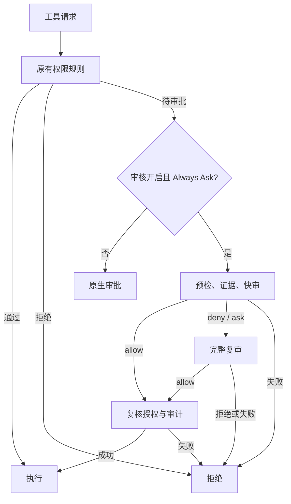

# 原生接入架构

[English](en/architecture.md) | [简体中文](architecture.md)

关闭两阶段时直接完整审核。两阶段使用相同证据，复审不读取快审结论；模型均不提供工具。

## 引擎与证据

`overlay/packages/agent-core-v2/src/agent/approvalReview/` 实现审核；`patches/native-review.patch` 接入待审批入口并载入配置权限规则。TUI 的直接通过、拒绝及业务确认沿用上游语义。无头模式的附加策略见下文。

只有根代理的真实请求、shell input、已验证审批和回答提供授权；assistant、摘要、委派、hook、工具结果和 shell output 不能授权。关联 `Read` 与有限验证输出只是不可信行为证据，分页、截断及未知脚本不能证明安全。动作和当前授权不静默截断，缺失或超预算均拒绝。

可恢复错误每阶段最多尝试 10 次，退避并遵循 Retry-After，共用总超时。连续两次基础设施失败冷却 30 秒；基础设施故障和证据不足不占安全停轮预算。连续 3 次或最近 50 个结果累计 10 次安全拒绝会停轮。审计失败拒绝执行，保留原安全结论。可拆分副作用更小的独立步骤，禁止绕道达到已拒绝效果。

## 一次授权与列表同步

main agent 的非 critical 模型拒绝最多保留 10 个挑战，同一 `{tool,args,cwd}` 指纹仅保留最新挑战。每次审核完成，通过 `ToolUpdate.customData` 发布带递增 sequence 的完整有效挑战快照，包含工具、参数和理由；通过、消费、替换、淘汰和上下文修订均反映在快照中。

TUI 校验当前 session、main agent 及完整记录后替换列表，忽略重复和迟到 sequence。已发送授权的挑战保持隐藏，直到引擎将其移出快照。快照自带工具信息，兼容早于工具开始或迟于结束的事件。

`/approval`（别名 `/approve`）列出精确拒绝，Enter 进入可滚动详情，默认取消；查看完整参数及 cwd 后，显式选择一次授权并再次 Enter 才提交。SDK 接收后才消费 TUI 记录并报告成功，失败可重试；显式 ID 入口共用确认。发送前重查 session、模式和挑战，独立提交入口不经过旁聊、媒体或缓存提示。

引擎在首次模型调用前验证用户通道、挑战、session/agent、完整指纹和 `prefixRevision()` 并原子消费。授权仅加入复审证据，不能绕过 protected action、显式 ask、critical 等约束，不生成 allow 规则。compaction、undo、clear、session reset 和重启使旧挑战失效。grant 从普通请求中过滤；importContext 标为不可信来源。

## 回答与原生审批

`interactions` 仅查询当前 session、main agent 的已解决记录。批准须 approved、未取消、字段完整且指纹匹配；一次批准在原审批接受或首次模型审核前消费，历史中已执行的批准也排除。session 批准仅在对应规则有效时可用，子代理不能消费根批准。

实际回答与不可信问题分开，支持问题键和无歧义选项；问题或无关肯定回答不能扩大授权。原记录及 createdAt 参与指纹，审核期间授权、规则、模型或配置变化使决定失效。记录限时、限量，不跨重启持久化。

审计保留指纹、结果和授权使用状态，不记录参数、回答、挑战、interaction ID 或模型自由生成理由。

## SDK 与运行包

TUI 通过 SDK 管理审核，不导入引擎服务。官方 CLI 的普通钩子不能解决核心待审批请求，因此构建独立运行时；`autokimi` 保留官方 `kimi`，默认共用账号和配置。其他版本须显式移植验证。

`upstream.lock.json` 固定精确提交。准备器在临时目录应用补丁和 overlay，成功才移入缓存；输入或源码状态变化时拒绝复用。生产打包前再次验证。

运行时、SDK 和生产依赖通过包内相对链接重建。依赖按确定遍历次序编号，保留同名同版本的不同解析节点，标识不含绝对路径。文件、权限和链接共同决定 release。安装复核摘要与版本，在 per-home 锁内更新配置、启动器和回执，失败回滚。摘要不是签名。

## 无头控制层

`patches/headless.patch` 将可选的 per-harness 控制器接入循环、模型请求、工具、权限模式及 SDK。主代理、子代理和审核请求共用累计预算与取消信号；不启用该选项时保留原有行为。CLI 只通过 SDK 创建、恢复和停止 session，不导入引擎内部服务。

CLI 的 `headless/` 维护私有请求、原子状态快照与追加事件日志，独立 worker 执行任务。提交幂等、单任务所有者、单 session 写锁及持久取消指令分开管理；恢复先核对旧 worker 已结束，再从日志恢复状态。原生 SDK 保留 session 历史和自身写锁。

无头模式保留原生 deny，文件能力检查早于原生 allow；有限只读集之外的直接 allow 转入审核。禁用自动目标/定时调度、无人值守一次授权和模式提权。事件协议、预算精度、恢复条件和 Bash 隔离边界见 [无头任务](headless.md)。

## 上游跟随

候选依次验证 CDN 版本、Git tag、npm SHA-512、签名和 provenance commit，并检查 Node、pnpm、原生依赖。独立源码目录完成构建、回归和隔离安装烟测；仅显式 `--install` 或 `upgrade` 切换安装，失败保留旧 release。

`build-kit/` 包含源码差异、工具、测试和文档，不含 Git 元数据。`check` 在仓库中使用 Git 清单，在 build-kit 中扫描源码并排除生成目录；均校验体积、敏感内容和文档链接。`git diff --check` 仅在自身有 Git 元数据时执行。更新工作与报告放在 `KIMI_CODE_HOME/autokimi/update-work`。没有后台更新，日常构建仍使用基线锁。
