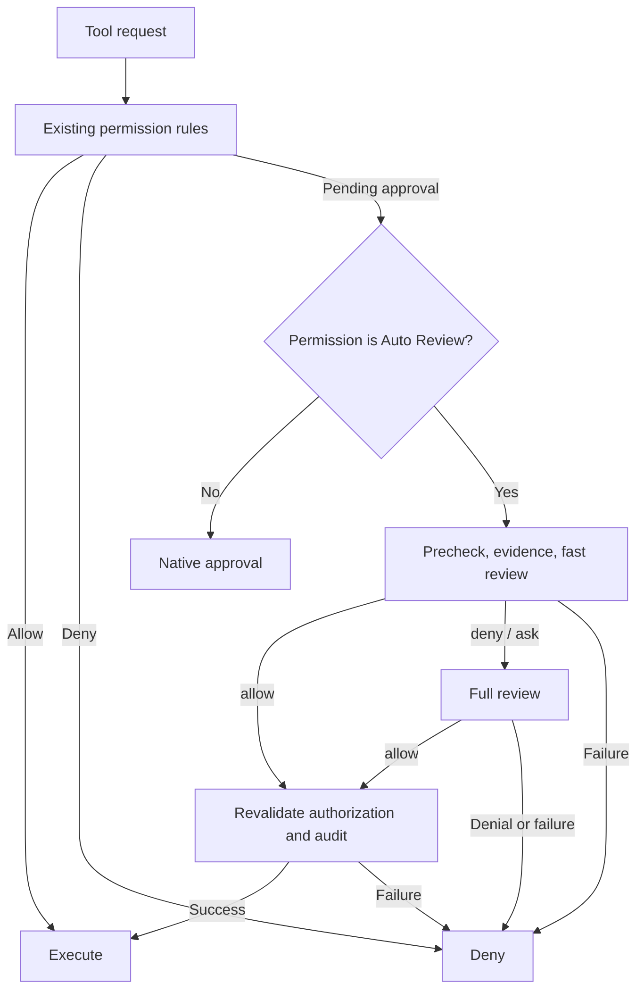

# Native integration architecture

[English](architecture.md) | [简体中文](../architecture.md)



With two stages disabled, full review runs directly. Both stages share evidence, the second does not see the first verdict, and neither model receives tools.

## Engine and evidence

`overlay/packages/agent-core-v2/src/agent/approvalReview/` implements review. `patches/native-review.patch` connects the pending-approval entry and loads configured permission rules. Direct allow, deny and task confirmation retain upstream semantics in the TUI. Headless execution adds the policy below.

Only real root-agent requests, shell input, verified approvals and answers provide authorization. Assistant messages, summaries, delegation, hooks, tool results and shell output cannot authorize actions. Related `Read` results and limited verification output are untrusted behavioral evidence. Pagination, truncation and unknown scripts cannot establish safety. Actions and current authorization are never silently truncated; missing or oversized evidence results in denial.

Recoverable errors retry at most 10 attempts per stage, with backoff and Retry-After under the shared deadline. Two consecutive infrastructure failures trigger a 30-second cooldown. Infrastructure failures and missing evidence do not consume the safety-stop budget. Three consecutive safety denials, or 10 among the last 50 results, stop the turn. Audit failure denies execution while retaining the original safety verdict. Independently verifiable steps with smaller effects are possible; routing around a denial to achieve the same effect is prohibited.

## One-time grants and list synchronization

At most 10 challenges are retained for non-critical model denials from the main agent. Only the latest challenge for a `{tool,args,cwd}` fingerprint remains. After each review, `ToolUpdate.customData` publishes a complete valid-challenge snapshot with an increasing sequence, including tool, arguments and reason. Allow, consumption, replacement, eviction and context revisions are reflected in snapshots.

The TUI validates the current session, main agent and complete records before replacing its list, ignoring duplicate or late sequences. Submitted challenges stay hidden until the engine removes them from its snapshot. Snapshots carry tool information, allowing events before tool start or after completion.

`/approval` (alias `/approve`) lists exact denials. Enter opens scrollable details with Cancel selected. After inspecting complete arguments and cwd, the user must explicitly select one-time approval and press Enter again. Only SDK acknowledgment consumes the TUI record and reports success; failure permits retry. Explicit-ID approval uses the same confirmation. Session, mode and challenge are rechecked before sending. The separate submission entry bypasses side conversations, media and cached prompts.

Before the first model call, the engine validates the user channel, challenge, session/agent, full fingerprint and `prefixRevision()`, then consumes the challenge atomically. A grant only adds re-review evidence. It cannot bypass protected actions, explicit ask rules or critical constraints, and creates no allow rule. Compaction, undo, clear, session reset and restart invalidate old challenges. Grants are filtered from ordinary requests; `importContext` is marked untrusted.

## Answers and native approvals

`interactions` queries only resolved records from the current session's main agent. Approval must be approved, not canceled, complete and fingerprint-matching. One-time approval is consumed when the original approval is accepted or before its first model review; historical approvals already used for execution are excluded. Session approval requires a valid corresponding rule. Subagents cannot consume root approvals.

Actual answers and untrusted questions remain separate, supporting question keys and unambiguous options. Questions and unrelated affirmative answers cannot expand authorization. Original records and `createdAt` contribute to fingerprints. Changes to authorization, rules, model or configuration during review invalidate the decision. Records have count and lifetime limits and do not persist across restart.

Audit retains fingerprints, results and authorization-use flags, without arguments, answers, challenges, interaction IDs or free-form model reasons.

## SDK and runtime packages

The TUI manages review through the SDK without importing engine services. Ordinary official CLI hooks cannot resolve the core pending-approval request, so AutoKimi builds a separate runtime. `autokimi` preserves official `kimi` and shares account and configuration by default. Other versions require explicit porting and validation.

`upstream.lock.json` pins the exact commit. The preparer applies patches and overlay in a temporary directory, moving it into the cache only on success. Changed inputs or source state prevent reuse. Production packaging validates it again.

The runtime, SDK and production dependencies are reconstructed through relative package links. Dependencies receive deterministic traversal IDs; distinct resolution nodes with the same name and version remain distinct, without absolute paths in identifiers. Files, permissions and links jointly determine the release identity. Installation verifies digests and versions, then updates configuration, launcher and receipt under a per-home lock, rolling back on failure. A digest is not a signature.

## Headless control

`patches/headless.patch` connects an optional per-harness controller to loops, model requests, tools, permission mode and the SDK. Main agents, subagents and reviewer requests share cumulative limits and cancellation. Without this option, existing behavior remains. The CLI creates, resumes and stops sessions through the SDK without engine-service imports.

The CLI's `headless/` module maintains private requests, atomic snapshots and an append-only journal. An independent worker executes each job. Submission deduplication, worker ownership, single-session writer leases and durable cancellation are separate. Recovery checks that the previous worker has ended, then restores journal state. Native SDK history and its own writer lock remain in use.

Headless execution retains native denials and checks file capabilities before native allow rules. Direct allows outside the limited read-only set enter review. Autonomous goals, scheduled jobs, unattended one-time grants and permission-mode escalation are disabled. See [headless tasks](headless.md) for events, budget precision, recovery and Bash isolation limits.

## Following upstream

Candidates verify the CDN version, Git tag, npm SHA-512, signatures and provenance commit, plus Node, pnpm and native dependencies. An isolated source directory is used for build, regression tests and installation smoke tests. Only explicit `--install` or `upgrade` changes installation; failures retain the old release.

`build-kit/` contains source differences, tools, tests and documentation, without Git metadata. `check` uses the Git file list in a checkout and scans source while excluding generated directories in a build-kit. Both validate size, sensitive content and documentation links. `git diff --check` runs only with the project's own Git metadata. Update work and reports live under `KIMI_CODE_HOME/autokimi/update-work`. There are no background updates; normal builds use the baseline lock.

## OS sandbox and file sinks

`autokimiSandbox` directly spawns the argv returned by the pinned Anthropic runtime. The runtime generates a trusted host wrapper and passes escaped user-command data to Seatbelt/bubblewrap for interpretation inside the sandbox. Inherited shell startup hooks, loader injection variables and common secret variables are scrubbed before spawning. The parent holds policy, domains and proxy lifecycle; SDK shutdown awaits cleanup. Permission failures never trigger an automatic unsandboxed retry. Model services, file tools and MCP sit outside this shell boundary.

`reviewSafeWrite` lives in the local filesystem backend, so plan and allow-rule shortcuts still reject multi-link files. Full writes validate and atomically replace rather than truncating the old inode; appends use verified descriptors. Review evidence includes current file identity, avoiding dependence on the historical-action window to infer aliases.

## Permission modes and session compatibility

Version 0.4.0 makes review a native `PermissionMode = manual | review | yolo | auto` across the engine, SDK, RPC, status events and transcript. The TUI picker and bottom bar read that state. `/auto-review` remains a compatibility command and reviewer settings entry. `auto` continues to mean Never Ask.

| Surface                  | Implementation boundary                                                                                                                                             |
| ------------------------ | ------------------------------------------------------------------------------------------------------------------------------------------------------------------- |
| Permission engine        | `review` retains manual-mode policy ordering and reviews pending actions; explicit deny wins and explicit ask cannot be automatically approved                      |
| Protocol and persistence | SDK, klient, server, transcript and telemetry enums agree; permission events carry version 2 with replayable version state                                          |
| TUI                      | Four picker options, status, compatibility commands and Goal confirmation; newer choices win asynchronous races                                                     |
| Delegation               | Ordinary subagents, forks, restored Swarm agents and Tower inherit `review` from a reviewing parent; Tower cannot force Never Ask across it                         |
| Headless                 | Agent creation and restoration enforce `review`, which cannot be switched off during a run; side-effect tools retain stricter review outside the safe read-only set |
| Independent controls     | OS sandbox, file-backend protection, model settings, context and cumulative budgets; questions, plan and Goal confirmation remain human decisions                   |

The top-level `autokimi_permission_mode` stores the AutoKimi default. Native `default_permission_mode` keeps its original three values. SDK `setConfig({ defaultPermissionMode })` writes the AutoKimi key, and reads report the effective default; `autokimiPermissionMode` is also available explicitly. Official Kimi ignores the additional key while login, providers, models and credentials stay shared. `experimental.approval_review` controls capability availability only; disabling it never silently selects a different mode.

New sessions, their indexes, workspace catalog, session locks and query cache live under `<KimiHome>/autokimi/`. Generic blob data stays shared. Older official clients cannot directly read new sessions containing `review`; this release does not export them back into the old format.

```sh
autokimi session legacy-list
autokimi session import <id>
autokimi -r <id>
```

Import copies one selected legacy session, rejecting source/target locks, duplicate IDs, links, special files and individual files over 256 MiB. It compares source state before and after copying, then publishes a staged copy atomically without changing the original. Close the source normally first; let that client safely clear locks left by a crash. History, context and cumulative usage stay in the copy. Headless run budgets still come from their own run journal.

Pre-version-2 `manual` sessions with effective review enabled migrate to `review`. Legacy manual/off, yolo and auto retain their mode. The version marker prevents a later explicit Always Ask choice from being re-enabled on resume. Every actual mode transition increments an authorization generation; a mode switch immediately cancels in-flight review requests, and pending decisions or unused one-time grants cannot survive a mode round trip.

Starting an agent from an invalid AutoKimi permission default fails explicitly, without falling back to native Never Ask.
