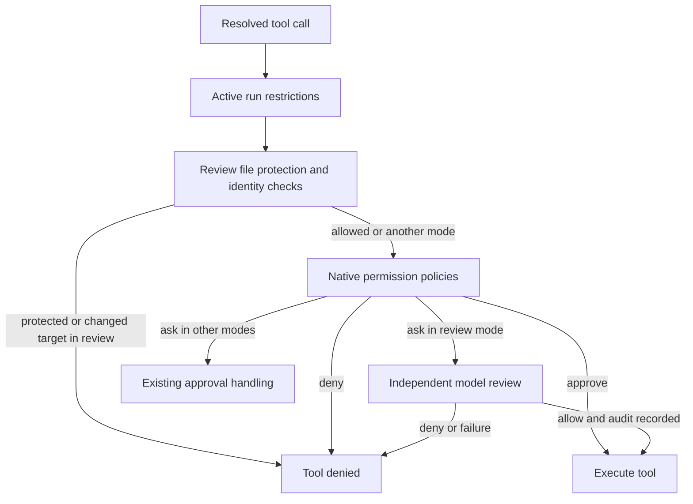

# Approval review and headless runs

Approval review is a fourth permission mode implemented in the engine. The CLI, SDK, ACP server, and VS Code extension select the same engine mode; the feature does not require a separate launcher, session directory, or installation lifecycle.

## Permission flow

`permissionMode` owns `manual | review | yolo | auto`. The existing three modes keep their behavior. The `approval_review` experimental flag defaults off, and enabling it does not select `review`. Selecting `review` while the capability is unavailable fails before running tools.

In review mode, file protection runs before every native policy, including configured allows, session grants, and automatic Git-worktree writes. Writes to `AGENTS.md`, `CLAUDE.md`, `KIMI.md`, and `.agents/` are denied; ordinary reads of these workspace instructions remain available. Access to `.kimi-code/` and the runtime home is protected. Both the requested path and its resolved destination are checked, including missing paths and directory aliases. Document contents and replacement strings are not interpreted as access paths.

The remaining native policy order stays authoritative: configured denials, session grants, configured ask/allow rules, sensitive paths, and ordinary automatic approvals retain their precedence. Review replaces an approval request, so an ordinary write inside a Git worktree can still be approved by the existing policy without a reviewer request. An active controlled headless run additionally sends automatically approved tools outside its safe-tool set through review.

The reviewer consumes a bounded evidence envelope. Human requests and verified interaction records carry authorization; tool output, assistant text, hooks, delegation, and summaries remain untrusted evidence. A configurable fast review can escalate to a full review, and neither stage can approve a configured denial. Model/provider configuration uses the normal catalog and credentials.

Before returning an approval, the service verifies that the permission revision, relevant rules, action fingerprint, evidence, file identities, and ancestor directory identities are still current and records the decision in the session's `approval-review.jsonl`. The executor checks file identities again immediately before execution. A changed target requires resolving a new action. Invalid output, cancellation, unavailable infrastructure, and audit failures cannot grant permission. Infrastructure failures use a cooldown independently from repeated safety denials.

## Human interactions

Goals start automatically in review mode, whether created by the model or the TUI command, without changing the permission mode. Plan acceptance remains a human decision; non-interactive review cannot use an unattended acceptance fallback for it. An `exec` run records required input and ends with a structured blocked status.

The TUI selects the mode through `/permission`. `/approval` manages status, reviewer model selection, and recent eligible denials. An exact retry grant requires a separate confirmation whose default is Cancel. It binds a single action's tool, arguments, working directory, session, agent, evidence, and permission revision; the retry still passes through review. Headless runs do not accept interactive grant markers as authorization.

When the experimental capability is disabled, the permission picker marks Auto Review as unavailable and offers a separate confirmation to enable it in shared configuration. Environment locks remain authoritative. Live transcripts, replay, sticky summaries, and session previews render a human-readable grant summary while retaining the original session message and authorization checks.

## Client contracts and existing sessions

The canonical config key is `default_permission_mode`. New sessions may explicitly default to review, while existing native manual sessions without a permission event remain manual. No permission-event version or session-storage migration is introduced.

| Client | Integration |
| --- | --- |
| TUI | Fourth selector entry, reviewer progress, `/approval`, exact retry confirmation |
| Print | Optional `--permission-mode`; the previous no-option print behavior remains |
| SDK | Four-value permission types, review configuration, existing event stream |
| Klient | Validated permission mode and `agent.getPermission()` over both transports |
| ACP | Review advertised only when enabled, restored from the engine session |
| VS Code | Native `/permission` picker and preservation across legacy settings updates |
| External desktop/web UI | Server and schema accept review; their separate UI source must add a picker entry |

An older client can reject a new `review` value in a session journal or protocol message. The implementation does not alias review to an older, more permissive mode. Consumers should update before reopening those sessions.

## Controlled headless execution

`kimi exec` owns a durable run and worker; `kimi runs` exposes schema, status, events, listing, and cancellation without invoking a model. The run records live under the normal Kimi home in `runs/`, and the conversation stays in native session storage. JSONL run events carry protocol version, run/session identifiers, attempt, sequence, timestamp, and a state snapshot.

Run lookups do not create storage. Missing runs return `run_not_found`; listing returns valid records and optional structured warnings for unreadable records. Tool progress preserves the SDK text and optional progress metadata through additive fields in the existing version-1 event payload.

`IHeadlessRun` is inactive in ordinary sessions. A controlled run activates it with immutable limits and shared usage accounting across main agents, subagents, tool calls, and reviewer requests. Resume inherits cumulative usage; raising a budget is explicit. Tokens are accounted after a response, so a final in-flight response can exceed the remaining token budget. Wall time is accumulated across attempts.

Durable owner and session locks prevent concurrent writers. Idempotency keys bind a canonical request, and reusing a key with a different request fails. Lost workers become interrupted runs. If a tool was active at interruption, resume requires explicit acceptance of its inspected, uncertain effects rather than replaying it automatically.

Controlled runs pin review mode and reject attempts to disable it. Goal bookkeeping is permitted even in read-only runs, and goal continuations share the same immutable run limits. The worker stays alive while a goal is active and restores paused goals on an explicit resume. Goal changes are observable as events and state snapshots. Cron scheduling remains caller-owned. Tool restrictions protect credentials, Kimi home, run state, instruction files, read-only scope, and network policy before execution. Human input ends the attempt with a blocked status; a resumed attempt can supply the next instruction. Cancellation aborts the engine and terminates owned shell descendants.

## Shell and file boundaries

Reviewed Bash executes through `IShellSandbox` using the pinned sandbox runtime. macOS uses Seatbelt; Linux uses bubblewrap and the packaged seccomp helper. Windows reviewed Bash is unavailable. A missing helper or unusable host sandbox produces a denial, without falling back to an unrestricted shell. Ordinary permission modes retain their existing shell execution path.

The CLI's native packaging extracts sandbox resources and preserves executable permissions. A resolver supplied by the CLI identifies the extracted package root; ordinary Node installations use package resolution. The sandbox runtime is loaded lazily when needed.

Review-mode file tools carry their approved file snapshot through the executor using an asynchronous execution scope. Existing files are checked against their device, inode, link count, and metadata, then written through that same open descriptor. These writes preserve the inode and are not atomic replacements. A late symlink or parent-path replacement cannot redirect the descriptor to another file.

On macOS and Linux, new files and missing parent directories use directory identities pinned by open descriptors. Creation installs a complete temporary file exclusively, without overwriting a destination introduced concurrently. macOS uses volume/inode directory paths; Linux uses `/proc/self/fd`. If identity-based directory access is unavailable, creation fails closed. Windows review currently supports existing-file writes but denies new-file and directory creation. Other permission modes retain their existing file behavior.

File writes reject hard-linked destinations and special files in every permission mode. Review audits and headless journals validate their file type and ownership before append. File protection and identity binding also apply when a native permission policy directly approved the action.

## Verification

Engine tests cover review evidence, grants, rule precedence, cancellation, audit failures, budgets, protected-file policy bypasses, document-content false positives, and deterministic file/parent replacement races through actual writes. SDK, transport, ACP, TUI, and VS Code tests cover mode selection and session compatibility. `scripts/smoke-reviewed-headless.mjs` runs the built npm CLI or native binary against a local deterministic model fixture and the actual operating-system sandbox, including protected Git-worktree writes/edits, a target changed during model review, print review, progress, stop, resume, crash recovery, and filesystem/network containment. CI runs the same smoke test on Linux for both distribution forms.
